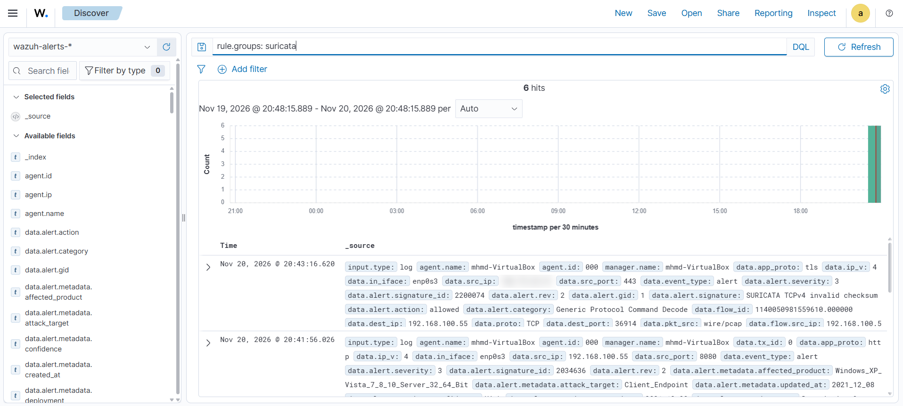

# Project 16: Suricata Network IDS with Wazuh

I added a network intrusion detection system (Suricata) to the Wazuh SIEM from my earlier projects, so network alerts and host events can be viewed in one dashboard. I tested it with controlled traffic from my own PC to a test web server on my own VM, and recorded what Suricata and Wazuh did with it.

> **Scope:** one sensor, one source machine, my own isolated lab. Suricata runs in **IDS (alert-only) mode**: it logs alerts and blocks nothing. This is a learning lab, not a production deployment.
> **AI assistance:** I used AI guidance throughout (Gemini for the lab steps, Claude for review). I ran the commands myself. Results marked *provisional* below were noted during the lab but I do not yet have raw output or a screenshot for them, so treat them as unverified.

## Short version

- Installed Suricata 8.0.8 with the Emerging Threats Open ruleset and fed its `eve.json` into my Wazuh manager. Suricata alerts show up in the Wazuh dashboard under the `suricata` group.
- I recorded a **baseline first**: a request for a sensitive-looking file got only a generic alert. Then I wrote one custom rule (sid 1000001) for it.
- A 15-port connection test alerted on only **3 ports**. Signatures are port-specific, so "no alert" did not mean "nothing happened".
- Failed SSH logins showed up in the host's auth log, but Suricata only saw metadata, because SSH is encrypted.
- Only the first alert is backed by a screenshot so far. The rest is provisional (see Limitations).

## Environment

| Component | Detail |
|---|---|
| Sensor and SIEM host | Linux Mint VM (VirtualBox, bridged, 6 GB RAM) |
| IDS | Suricata 8.0.8, IDS mode, af-packet on the bridged interface |
| Rules | Emerging Threats Open (69,559 rules, 53,582 enabled) plus 1 custom rule (sid 1000001) |
| SIEM | Wazuh 4.14.9 single node (manager, indexer, dashboard) from Project 13 |
| Traffic source | My physical Windows 11 PC on the home LAN |
| Test target | A simple test web server on the Mint VM, port 8080 |
| Decoders | None written. Wazuh reads Suricata's `eve.json` as JSON |

```
Windows PC (test traffic) ---> Mint VM: Suricata (IDS mode) ---> /var/log/suricata/eve.json
                                                                        |
                                                  Wazuh manager reads it (JSON localfile)
                                                                        |
                                                              Wazuh dashboard (group: suricata)
```

## What I built

1. Installed Suricata from the OISF stable PPA and set the capture interface.
2. Loaded the Emerging Threats Open ruleset with `suricata-update`.
3. Added one local rule file (`local.rules`) with a custom rule, sid 1000001.
4. Pointed the Wazuh manager at `/var/log/suricata/eve.json` with a `<localfile>` entry (`log_format: json`) and restarted it.
5. Generated test traffic from my PC and checked the alerts on both sides.


*Discover filtered to `rule.groups: suricata`: 6 hits from agent 000 (the manager). The first alert, sid 2034636, appears at 20:41:56, two seconds after the first test request.*

## Tests and results

All traffic went from my PC to my own Mint VM. Times are +08:00. "Provisional" means I have no raw output or screenshot for it yet.

| # | What I did | Time | Suricata | Wazuh | Status |
|---|---|---|---|---|---|
| T1 | 3 HTTP requests to my test server with a scanner-style User-Agent string (no scanning tool was run) | 20:41:54 | sid 2008538 (ET SCAN, severity 2) and sid 2034636 (ET INFO Python SimpleHTTP server banner, severity 3) | Noted as rule 86601, level 3 | Banner alert seen in the screenshot. The rest is provisional |
| T2 | A simulated path-traversal request to my test server | 20:49:50 | sid 2049400 (ET WEB_SERVER /etc/passwd in URI) | Noted as rule 86601, level 3 | Provisional |
| T3 | TCP connection attempts to 15 ports | 20:52:07 | Alerts on **3 of 15** ports (1433, 3306, 5432): sids 2010935, 2010937, 2010939 | Noted as rule 86601, level 3 | Provisional |
| T4 | 3 failed SSH logins | 20:52:58 | No alert, only 3 SSH metadata events | Host auth log gave rule 5710 (level 5), 6 alerts for 3 attempts | Provisional. The 6 vs 3 is not explained yet |
| T5a | Request for `/backup/db_dump.sql` **before** my custom rule (baseline) | 20:54:02 | Only the generic banner alert (2034636) | Same | Provisional |
| T5b | The same request **after** adding the custom rule | 20:57:01 | sid 1000001 "CUSTOM HTTP Sensitive Backup File Probe" | Noted as rule 86601, level 3 | Provisional |

### What I take from this, and what I don't

- The Suricata to Wazuh path works. The screenshot shows it.
- T5a then T5b is the part I care about most: show the gap first, then close it. I still need the raw output to prove it.
- A 15-port test alerting on 3 ports shows that ET signatures are port-specific. A quiet result is not proof that nothing happened.
- An IDS sees encrypted traffic like SSH only as metadata. The failed logins were visible in the host log, not in Suricata.
- I make **no** claim of detecting a port scan, an attack or a tool. These were controlled requests to my own server.

## Custom rule

```
[PASTE THE EXACT sid 1000001 RULE FROM local.rules]
```

## Known issues

- **Checksum noise.** The screenshot also shows sid 2200074 (SURICATA TCPv4 invalid checksum) from a public IP to the VM. This is the usual VirtualBox checksum-offload noise on a bridged VM. I have not tuned it out. `[UPDATE if fixed or suppressed]`
- **Wazuh levels.** My notes say every Suricata alert arrived as Wazuh rule 86601 at level 3, whatever Suricata's severity. I have not checked this against `alerts.json` or Wazuh's rule file yet.

## Problems and corrections

- My first review of the lab found one screenshot, no raw output, no baseline and no explanation of the checksum noise. The table above says plainly which results are verified and which are not.
- I decided to publish with the gaps documented rather than wait, so this README states them instead of hiding them.

## Limitations

- IDS only, alert-only. One sensor, one source machine, one run per test, small traffic volumes.
- Several results are provisional (no raw output or screenshot yet).
- No host-versus-network correlation timeline yet.
- ET Open rules used as shipped, with no tuning beyond the one custom rule.
- Built with AI guidance. This is student lab work, not professional experience.

## Cleanup

`[CONFIRM BEFORE PUSHING: test web server stopped, test ports closed, no public IPs, SIDs or passwords visible in screenshots, browser tab strip cropped]`

## What I would do next

- Capture raw `jq` output for T1 to T5b and replace "provisional" with evidence.
- Check how Wazuh maps Suricata severity to rule levels.
- Fix or document the checksum noise.
- Add a correlation timeline: one Suricata alert next to the matching host event.
